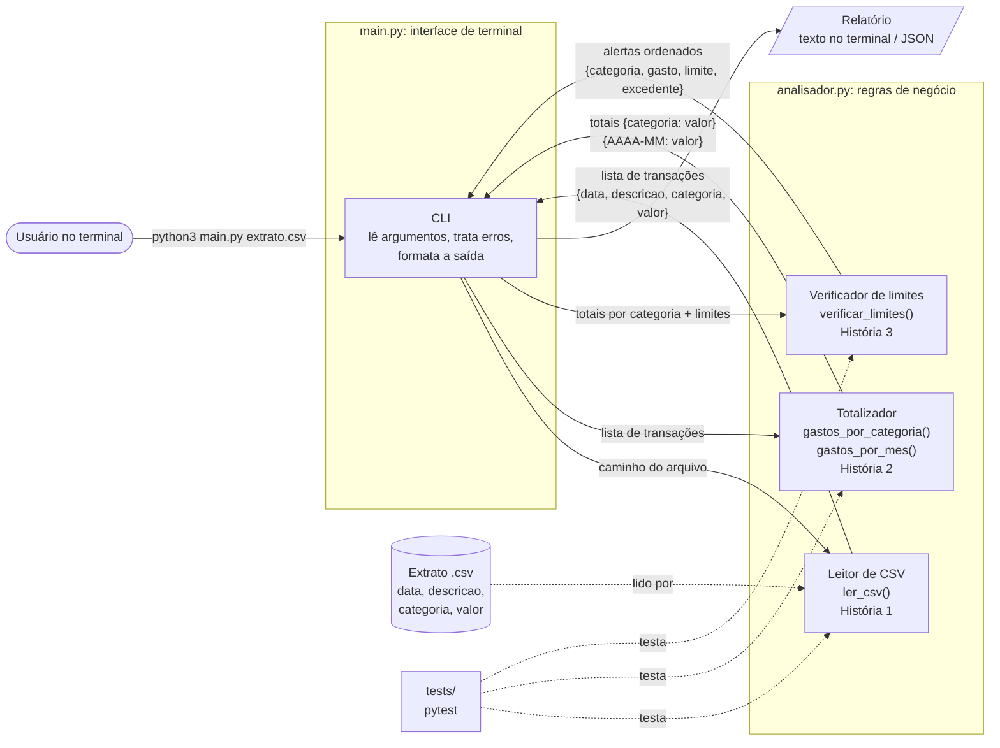

# Arquitetura: Analisador de Gastos Pessoais

O sistema roda em Python, pelo terminal. Ele é dividido em uma camada de interface (`main.py`) e uma camada de regras (`analisador.py`), testada de forma isolada pelos testes em `tests/`.

## Diagrama

## Componentes e responsabilidades

| Componente | Onde | Responsabilidade | História |
|---|---|---|---|
| CLI | `main.py` | Recebe o caminho do CSV pela linha de comando, chama as regras na ordem certa, mostra o resultado formatado e transforma erros (`ValueError`, arquivo inexistente) em mensagens amigáveis | todas |
| Leitor de CSV | `analisador.ler_csv` | Abre o arquivo, confere se as colunas `data`, `descricao`, `categoria` e `valor` existem, converte a data DD/MM/AAAA para `date` e o valor (aceitando vírgula decimal) para `float`. Erros informam a coluna que falta ou a linha com problema | 1 |
| Totalizador | `analisador.gastos_por_categoria`, `analisador.gastos_por_mes` | Soma os valores por categoria (sem diferenciar maiúsculas de minúsculas) e por mês (`AAAA-MM`) | 2 |
| Verificador de limites | `analisador.verificar_limites` | Compara os totais por categoria com os limites do usuário e gera alertas ordenados pelo excedente. Recusa limite negativo | 3 |
| Testes automatizados | `tests/` | Especificam os critérios de aceitação de cada história com pytest | todas |

## Comunicação entre os componentes

1. O usuário chama `python3 main.py <arquivo.csv>`.
2. A CLI passa o caminho para `ler_csv`, que devolve uma **lista de transações**. Cada transação é um `dict` com `data` (`date`), `descricao` (`str`), `categoria` (`str`) e `valor` (`float`).
3. A CLI passa essa lista para o Totalizador, que devolve dicionários de **totais** (`{categoria: total}` e `{"AAAA-MM": total}`).
4. A CLI passa os totais por categoria e os limites do usuário para o Verificador, que devolve a **lista de alertas** (`{categoria, gasto, limite, excedente}`).
5. A CLI monta o relatório final em texto (ou JSON).

As regras não fazem `print` nem leem do teclado: recebem dados e devolvem dados. Quando algo está errado, elas lançam `ValueError`, e só a CLI fala com o usuário. Por isso dá para testar cada regra isoladamente.
