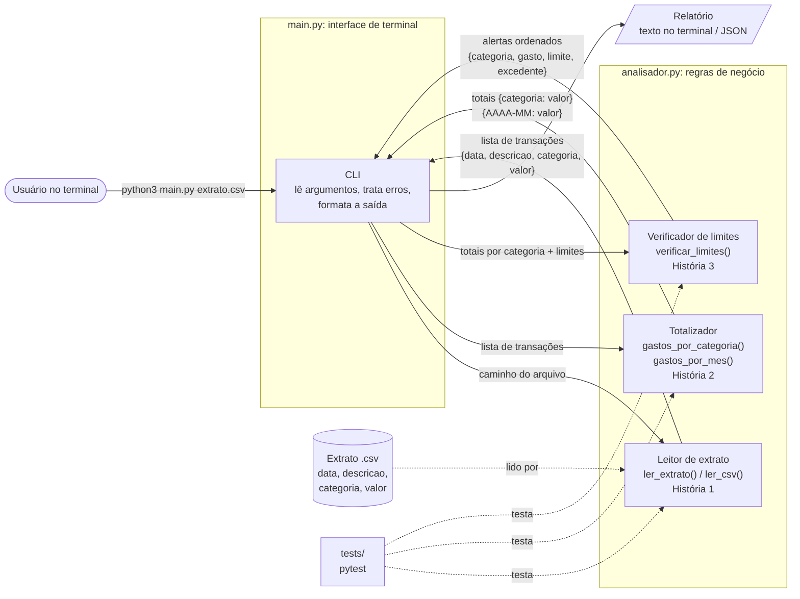
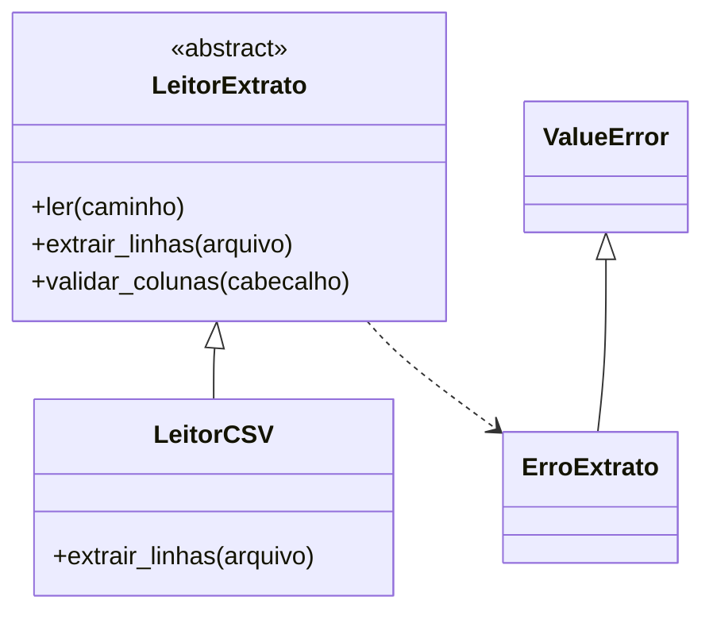
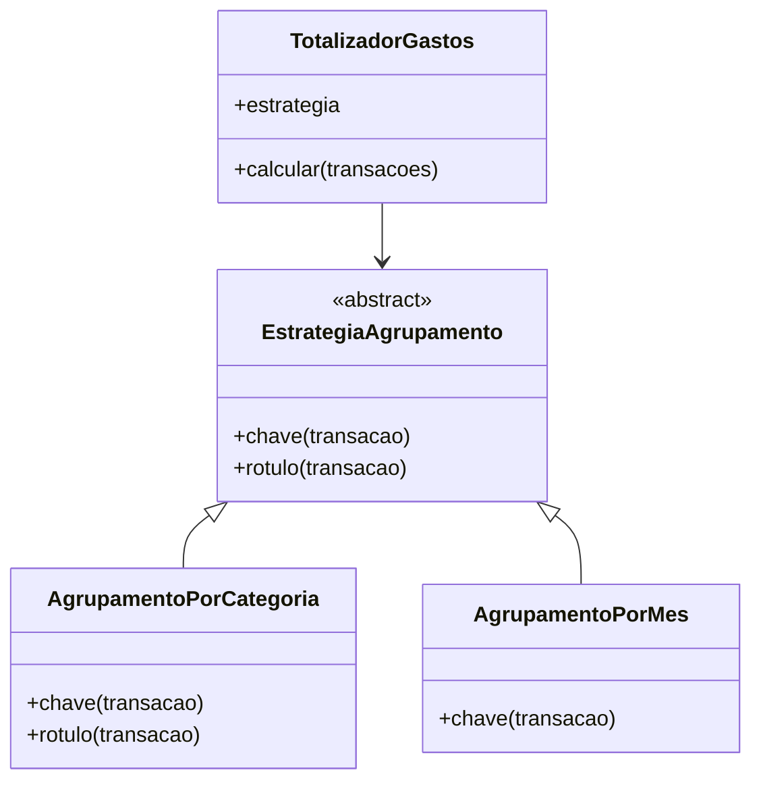
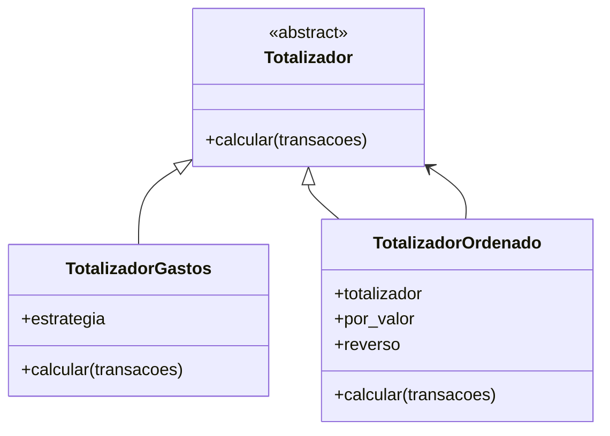

# Arquitetura: Analisador de Gastos Pessoais

O sistema roda em Python, pelo terminal. Ele é dividido em uma camada de interface (`main.py`) e uma camada de regras (`analisador.py`), testada de forma isolada pelos testes em `tests/`.

## Diagrama

## Componentes e responsabilidades

| Componente | Onde | Responsabilidade | História |
|---|---|---|---|
| CLI | `main.py` | Recebe o caminho do CSV pela linha de comando, chama as regras na ordem certa, mostra o resultado formatado e transforma erros (`ValueError`, arquivo inexistente) em mensagens amigáveis | todas |
| Leitor de extrato | `analisador.ler_extrato`, `analisador.ler_csv`, `LeitorExtrato`, `LeitorCSV`, `criar_leitor` | Confere se as colunas `data`, `descricao`, `categoria` e `valor` existem, converte a data DD/MM/AAAA para `date` e o valor (com vírgula, ponto de milhar ou `R$`) para `float`. Aceita `,` ou `;` como separador. Os erros informam a coluna que falta ou a linha com problema | 1 |
| Totalizador | `analisador.gastos_por_categoria`, `analisador.gastos_por_mes` | Soma os valores por categoria (sem diferenciar maiúsculas de minúsculas) e por mês (`AAAA-MM`) | 2 |
| Verificador de limites | `analisador.verificar_limites` | Compara os totais por categoria com os limites do usuário e gera alertas ordenados pelo excedente. Recusa limite negativo | 3 |
| Testes automatizados | `tests/` | Especificam os critérios de aceitação de cada história com pytest | todas |

## Comunicação entre os componentes

1. O usuário chama `python3 main.py <arquivo.csv>`.
2. A CLI passa o caminho para `ler_extrato`, que devolve uma **lista de transações**. Cada transação é um `dict` com `data` (`date`), `descricao` (`str`), `categoria` (`str`) e `valor` (`float`).
3. A CLI passa essa lista para o Totalizador, que devolve dicionários de **totais** (`{categoria: total}` e `{"AAAA-MM": total}`).
4. A CLI passa os totais por categoria e os limites do usuário para o Verificador, que devolve a **lista de alertas** (`{categoria, gasto, limite, excedente}`).
5. A CLI monta o relatório final em texto (ou JSON).

As regras não fazem `print` nem leem do teclado: recebem dados e devolvem dados. Quando algo está errado, elas lançam `ValueError`, e só a CLI fala com o usuário. Por isso dá para testar cada regra isoladamente.

## Padrões de projeto na História 1 (Sprint 4)

- **Template Method** (`LeitorExtrato.ler`): os passos da leitura são sempre os mesmos (abrir, validar colunas, converter as linhas). O `LeitorCSV` só implementa `extrair_linhas`.
- **Factory** (`criar_leitor`): escolhe o leitor pela extensão do arquivo usando o dicionário `LEITORES`. Se um dia formos ler OFX, é só criar um `LeitorOFX` e colocar no dicionário.

## Padrões de projeto na História 2 (Sprint 4)

- **Strategy** (`EstrategiaAgrupamento`): evita repetir o laço de soma entre `gastos_por_categoria` e `gastos_por_mes`. Cada regra de agrupamento (`AgrupamentoPorCategoria`, `AgrupamentoPorMes`) fica isolada em uma classe.
- **Decorator** (`TotalizadorOrdenado`): ordena os resultados (meses em ordem crescente e categorias do maior gasto para o menor) envolvendo um `Totalizador`, sem complicar `TotalizadorGastos`.

## Refatoração na História 3 (Sprint 4)
A função verificar_limites fazia tudo sozinha: validava os limites, montava o alerta e ordenava. A refatoração foi por extração de funções, sem mudar o comportamento, e os testes continuaram passando. Nenhum padrão de projeto foi aplicado nesta história.

