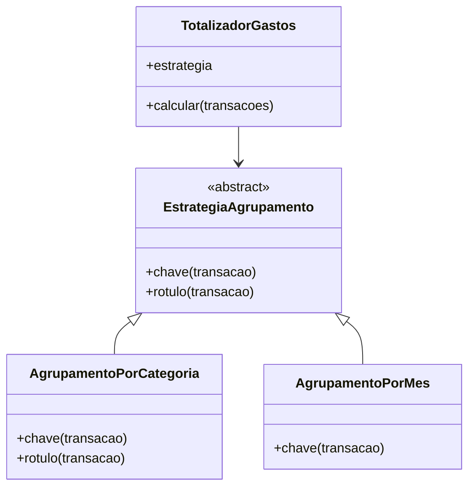
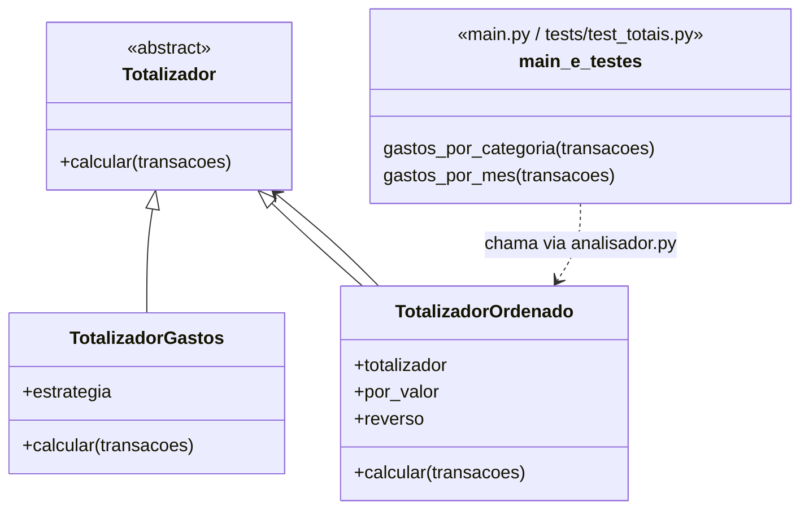

# Sprint 4 - História 2 (Guilherme Rozzi)

## O que foi refatorado

Na Sprint 3 (commit `fbc098e`), as funções `gastos_por_categoria` e `gastos_por_mes` em `analisador.py` funcionavam e passavam nos testes, mas repetiam o mesmo `for transacao in transacoes` para somar os valores. Além disso, `gastos_por_categoria` misturava a soma com a limpeza de texto das categorias, e `main.py` precisava ordenar os meses na mão porque o dicionário vinha sem ordem fixa.

| Antes (Sprint 3) | Depois (Sprint 4) |
|---|---|
| Dois laços de soma repetidos em `gastos_por_categoria` e `gastos_por_mes` | Um único laço em `TotalizadorGastos.calcular`, variando só a estratégia |
| Normalização de categoria misturada com o acúmulo | Regra isolada em `AgrupamentoPorCategoria` (com fallback para `"Sem categoria"`) |
| Meses sem ordenação garantida | `TotalizadorOrdenado` ordena os meses cronologicamente e as categorias por maior gasto |
| Soma direta sujeita a ruído de `float` | `TotalizadorGastos` arredonda os totais para 2 casas decimais |

As assinaturas de `gastos_por_categoria(transacoes)` e `gastos_por_mes(transacoes)` continuam iguais, então `main.py`, os testes originais de `tests/test_totais.py` e `verificar_limites` (História 3) não precisaram mudar.

## Padrões de projeto aplicados na História 2

Junto com o Template Method e a Factory que já estavam na História 1 (`LeitorExtrato` e `criar_leitor`), o projeto fecha 4 padrões ao todo com os 2 aplicados aqui:

### 1. Strategy (`EstrategiaAgrupamento`)

As duas funções faziam o mesmo cálculo de soma e só mudavam na forma de escolher a chave e o nome exibido de cada grupo. Separar isso em `EstrategiaAgrupamento` (`AgrupamentoPorCategoria` e `AgrupamentoPorMes`) tira a duplicação de `TotalizadorGastos` e permite criar outro tipo de agrupamento (como por ano) sem mexer no código que soma.

### 2. Decorator (`TotalizadorOrdenado`)

Para ordenar os totais (meses em ordem crescente e categorias do maior gasto para o menor) sem encher `TotalizadorGastos` de parâmetros ou criar subclasses diferentes para cada combinação, `TotalizadorOrdenado` implementa a mesma interface `Totalizador` e envolve outro `Totalizador` para ordenar o resultado retornado.

## Testes

Rodando `python3 -m pytest -v`, todos os 17 testes passam (os 5 da História 1, os 5 da História 3 e os 7 da História 2 em `tests/test_totais.py`, mantendo os 4 testes originais intactos).
