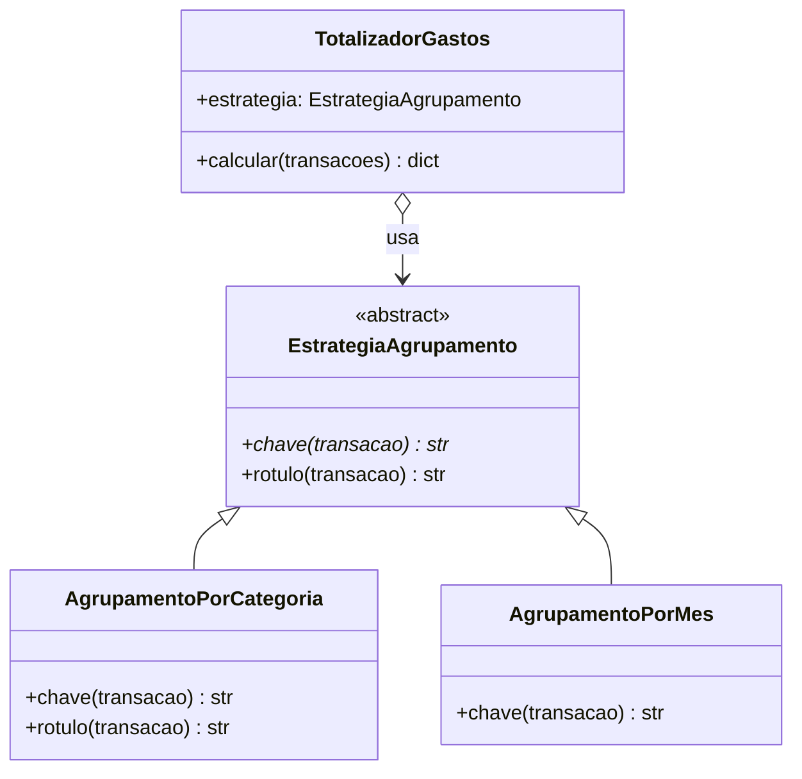
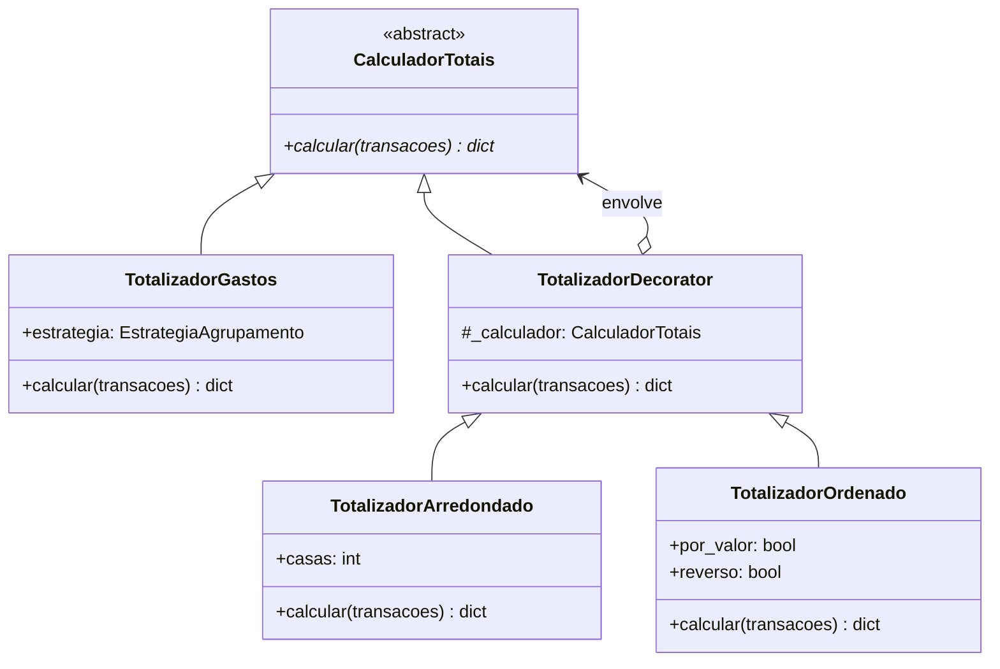
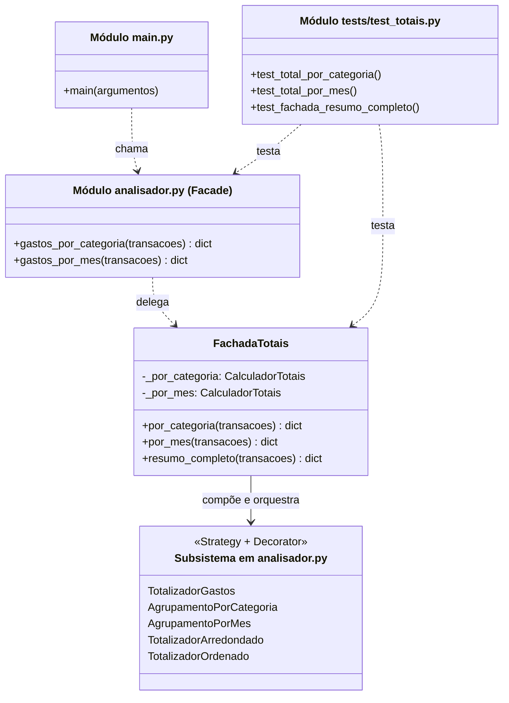

# Sprint 4 — Refatoração e Padrões de Projeto (História 2)

**Responsável:** Guilherme Rozzi (`gdicati`)  
**História:** História 2 — Ver quanto gastei por categoria e por mês  
**Módulos envolvidos:** `analisador.py` (regras de negócio) e `tests/test_totais.py` (testes automatizados)

---

## 1. Evidências de Refatoramento (em vez de reescrita completa)

Na Sprint 3 (commit `fbc098e`), a História 2 foi entregue com duas funções procedurais independentes em `analisador.py`: `gastos_por_categoria(transacoes)` e `gastos_por_mes(transacoes)`. Embora atendessem aos critérios iniciais, o código apresentava problemas estruturais:

| Aspecto | Antes (Sprint 3 — `fbc098e`) | Depois (Sprint 4 — `c41a026` e `14f164f`) |
|---|---|---|
| Laço de agregação | Duplicado em `gastos_por_categoria` e `gastos_por_mes` | Unificado em `TotalizadorGastos.calcular`, variando apenas a `EstrategiaAgrupamento` |
| Normalização de categorias | Misturada ao laço de soma (`nomes_originais` dentro de `gastos_por_categoria`) | Isolada em `AgrupamentoPorCategoria` (com tratamento para espaços extras e categoria vazia) |
| Precisão de ponto flutuante | Soma direta em `float`, sujeita a ruído binário (ex.: `0.1 + 0.2`) | Arredondamento composicional via `TotalizadorArredondado` |
| Ordenação dos resultados | Sem ordenação garantida (exigia ordenação manual em `main.py`) | Ordenação configurável via `TotalizadorOrdenado` (cronológica por mês e decrescente por valor em categorias) |
| Compatibilidade externa | Funções `gastos_por_categoria` e `gastos_por_mes` | Assinaturas, tipos de retorno (`dict[str, float]`) e chamadas em `main.py` e `tests/test_totais.py` **100% preservados** via `FachadaTotais` |

### Histórico incremental no Git

A refatoração foi aplicada de forma incremental sobre o código existente, preservando os 4 testes originais de `tests/test_totais.py` e os demais módulos do projeto:

1. **`c41a026` — `historia 2: extrai Strategy de agrupamento para eliminar duplicacao nos totais`**  
   Extração de `EstrategiaAgrupamento`, `AgrupamentoPorCategoria`, `AgrupamentoPorMes` e `TotalizadorGastos` a partir do código original de `gastos_por_categoria` e `gastos_por_mes`, mantendo os 14 testes existentes passando.
2. **`14f164f` — `historia 2: aplica Decorator e Facade no totalizador e amplia testes`**  
   Introdução da interface `CalculadorTotais`, dos decorators `TotalizadorDecorator`, `TotalizadorArredondado` e `TotalizadorOrdenado`, e da fachada `FachadaTotais`, além da ampliação de `tests/test_totais.py` (19 testes passando).

---

## 2. Padrões de Projeto Aplicados e Justificativas

### Padrão 1: Strategy (Comportamental)

- **Classes reais (`analisador.py`):** `EstrategiaAgrupamento` (abstrata), `AgrupamentoPorCategoria`, `AgrupamentoPorMes` e `TotalizadorGastos` (contexto).
- **Justificativa da escolha:**  
  No código original, `gastos_por_categoria` e `gastos_por_mes` repetiam exatamente a mesma estrutura de iteração e acumulação sobre `transacoes`, mudando apenas a forma de extrair a chave de agrupamento e o rótulo de exibição (categoria *case-insensitive* preservando a primeira grafia vs. mês `AAAA-MM`). O padrão **Strategy** elimina essa duplicação ao encapsular cada critério de agrupamento em uma subclasse de `EstrategiaAgrupamento`. Assim, novos agrupamentos (por exemplo, por ano ou por forma de pagamento) podem ser adicionados criando uma nova estratégia sem modificar `TotalizadorGastos` (Princípio Aberto/Fechado).

---

### Padrão 2: Decorator (Estrutural)

- **Classes reais (`analisador.py`):** `CalculadorTotais` (Component), `TotalizadorGastos` (ConcreteComponent), `TotalizadorDecorator` (Decorator), `TotalizadorArredondado` e `TotalizadorOrdenado` (ConcreteDecorators).
- **Justificativa da escolha:**  
  Além de somar os valores, a totalização financeira precisa lidar com pós-processamentos opcionais e combináveis: arredondar valores `float` para 2 casas decimais e ordenar os resultados (por mês em ordem cronológica ou por categoria do maior gasto para o menor). Colocar essas opções como flags dentro de `TotalizadorGastos` violaria o Princípio da Responsabilidade Única, e criar subclasses para cada combinação (`TotalizadorMesOrdenadoArredondado`, etc.) geraria explosão de classes. O padrão **Decorator** permite empilhar comportamentos (`TotalizadorOrdenado(TotalizadorArredondado(TotalizadorGastos(...)))`) de forma flexível mantendo a mesma interface `CalculadorTotais`.

---

### Padrão 3: Facade (Estrutural)

- **Classes e funções reais:** `FachadaTotais`, `gastos_por_categoria(transacoes)` e `gastos_por_mes(transacoes)` em `analisador.py`, consumidos por `main.py` e `tests/test_totais.py`.
- **Justificativa da escolha:**  
  Com a introdução das estratégias e dos decorators, montar um totalizador completo exige instanciar e encadear vários objetos (`AgrupamentoPorCategoria`, `TotalizadorGastos`, `TotalizadorArredondado`, `TotalizadorOrdenado`). Expor essa complexidade diretamente para `main.py` ou para os testes acoplaria os clientes à estrutura interna da refatoração. A `FachadaTotais` (e as funções de fachada `gastos_por_categoria` e `gastos_por_mes` em `analisador.py`) fornece uma interface única e simples (`por_categoria`, `por_mes`, `resumo_completo`), preservando a compatibilidade com `main.py`, com a História 3 (`verificar_limites`) e com os testes preexistentes.

---

## 3. Verificação dos Testes Automatizados

Após todas as refatorações, a suíte completa do projeto executada com `python -m pytest -v` obteve **19 testes aprovados (0 falhas)**:

- `tests/test_carregar_csv.py`: 5 testes (História 1 — inalterada)
- `tests/test_limites.py`: 5 testes (História 3 — inalterada)
- `tests/test_totais.py`: 9 testes (4 critérios originais da História 2 + 5 testes cobrindo Strategy, Decorator, Facade e casos de borda)
